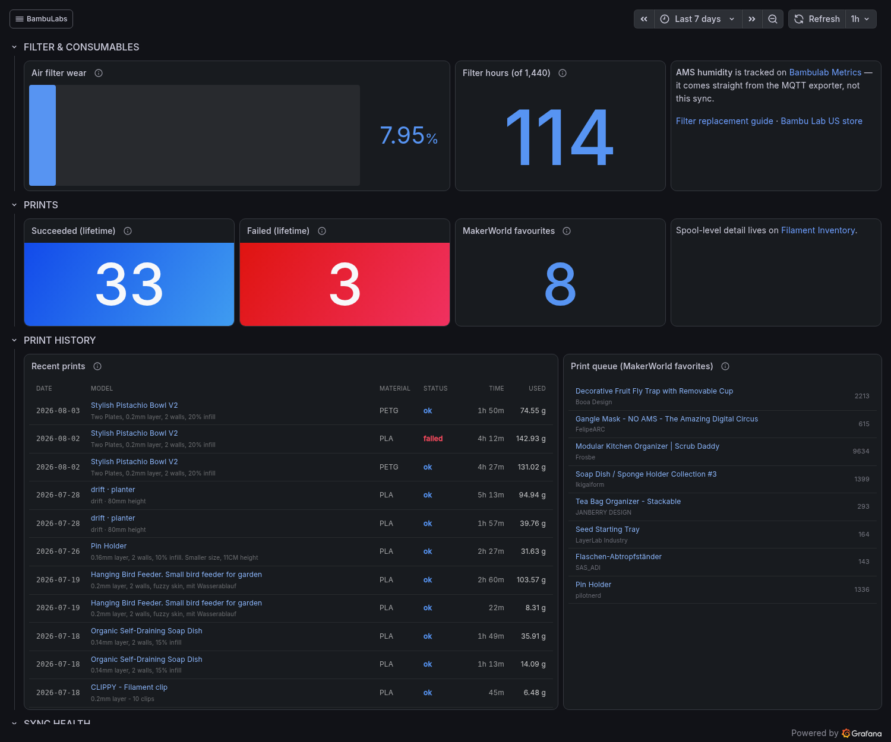
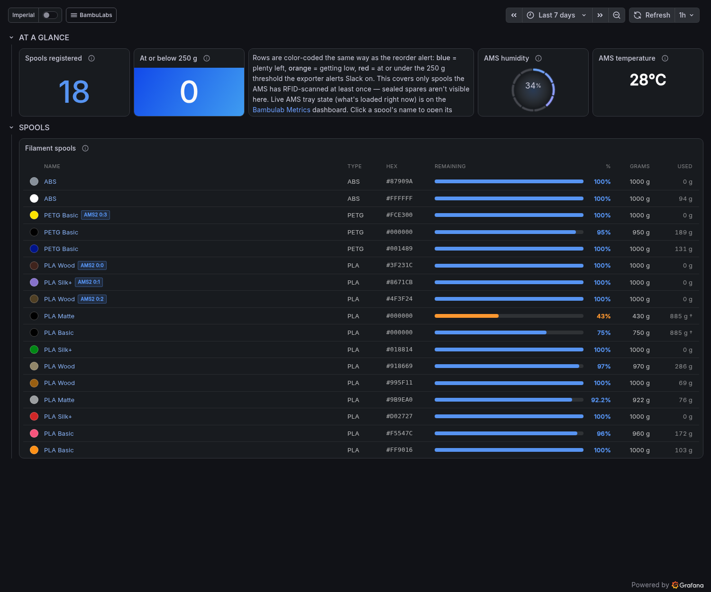

# bambu-sync

**A Prometheus exporter for the Bambu Lab Cloud API** — print history, RFID
filament inventory, and MakerWorld favourites — with Slack alerting for the
conditions worth acting on.

It is a **companion to a LAN MQTT exporter, not a replacement.** Those read the
*device*: temperatures, fans, print progress, live AMS state. This reads the
*account*: what you have printed, which spools exist and how full they are, and
what you have bookmarked. Same printer, different data source.

> **Unofficial API.** `api.bambulab.com` is reverse-engineered and undocumented.
> Bambu can change or break it without notice. This tool is **read-only** — it
> never starts a print and never touches the printer's queue. Field mappings
> here were confirmed against an X2D; other models may differ.

## Metrics

**Full reference: [docs/METRICS.md](docs/METRICS.md)** — every metric, its
labels, and the caveats that matter.

Naming convention: **`bambu_*` is the cloud plane** (this exporter, reading
your *account*). **`bambulab_*` is the device plane** (the LAN MQTT exporters,
reading the *printer*). They do not overlap and neither replaces the other.

| Group | |
| --- | --- |
| **Filament** | Per-spool remaining weight and percent, lifetime consumption, depleted flag |
| **Prints** | Recent prints with model, URL, slicer profile, duration and grams; success/failure counts; per-material aggregates |
| **Consumables** | Activated-carbon filter wear against its 1,440-hour interval |
| **Printer** | Identity and cloud-side online status |
| **MakerWorld** | Favourites, treated as a print queue |
| **Exporter health** | `up`, last-run, duration, build info, per-endpoint error counter, token expiry |

Four things are worth knowing before you build anything on these:

- **Count spools with `bambu_spools_registered`, not `count()`.** Two rolls of
  the same product are identical in every field the API gives us, so they
  share a label set; the `spool` label (empty, then `"2"`, `"3"`…) is what
  keeps them distinct series. The gauge is the exporter's own tally and is
  right either way.
- **`bambu_spool_used_grams` is not always summable.** Print history reports
  only the broad material, never the variant, so two same-colour spools share
  one figure. It carries an `ambiguous` label saying so. Summing blindly
  reports 1,770 g from 885 g of filament.
- **Only RFID-registered spools appear.** Sealed spares the AMS has never
  scanned are invisible, so "nothing running low" means nothing low *among
  what has been loaded*.
- **`bambu_device_info`'s `product_name` is the only accurate model
  identification available** — MQTT exporters report an X2D as an X1C, because
  the LAN payload cannot express the difference.

## Dashboards

Two example dashboards in [`dashboards/`](dashboards/), ready to import.



**Maintenance & History** — filter wear, print history with duration and
slicer profile, MakerWorld queue, and sync health including token expiry.



**Filament Inventory** — registered spools with levels, reorder threshold,
lifetime usage, and which spool is in which AMS slot. AMS humidity and
temperature come from the MQTT exporter, not this one.

> **These are examples, not a maintained product.** Datasources are template
> variables, so set them on import. They are Grafana schema **v2**
> (`dashboard.grafana.app/v2`), which is recent — older Grafana will not import
> them directly. Adapt them; do not expect updates.

## Configuration

All configuration is environment variables; nothing site-specific is compiled
in. Secrets are read from **files**, not values, and re-read every cycle — so a
rotated Kubernetes Secret is picked up without a restart.

| Variable | Default | |
| --- | --- | --- |
| `BAMBU_TOKEN_FILE` | `/etc/bambu/token` | Bearer token |
| `BAMBU_TOKEN_EXPIRY_FILE` | `/etc/bambu/expires` | `YYYY-MM-DD`; see below |
| `BAMBU_API_BASE_URL` | `https://api.bambulab.com/v1` | The `/v1` is mandatory |
| `SLACK_ALERTS_ENABLED` | `false` | Explicit; ships disabled |
| `SLACK_WEBHOOK_FILE` | `/etc/bambu/slack-webhook` | Incoming webhook URL |
| `SLACK_USERNAME` / `SLACK_ICON_EMOJI` | `Bambu Sync` / `:printer:` | |
| `HUMIDITY_METRICS_URL` | *(unset — disabled)* | e.g. `http://bambulab-exporter:9109/metrics` |
| `HUMIDITY_METRIC_NAME` | `bambulab_ams_unit_humidity` | |
| `SYNC_DAILY_AT` | `07:00` | Local time, honours `TZ` across DST |
| `SYNC_FAST_INTERVAL` | `30m` | Current print **and** spool refresh — 2 API calls a cycle |
| `SYNC_FULL_INTERVAL` | `24h` | Fallback cadence — see below |
| `BAMBU_STORE_URL` | `https://us.store.bambulab.com` | Regional storefront for product links |
| `HISTORY_LIMIT` | `100` | Prints **fetched**; aggregates span all of them |
| `LOW_GRAMS` | `250` | Reorder threshold |
| `HUMIDITY_WARN` / `HUMIDITY_CRIT` | `30` / `45` | % RH |
| `FILTER_INTERVAL_HOURS` | `1440` | |
| `TOKEN_WARN_DAYS` | `14` | Warn this far ahead of expiry |
| `TOKEN_RENEWAL_NOTE` | *(unset)* | Free text appended to token alerts: where the secret lives |
| `FAVORITES_LIMIT` / `PRINT_INFO_LIMIT` | `25` / `20` | Cardinality caps |
| `LISTEN_ADDR` | `:9110` | |
| `ENABLE_PPROF` | `false` | Serve `/debug/pprof` — **opt-in**, see below |
| `TZ` | `UTC` | |

Humidity thresholds sit deliberately **above** Bambu's stated <20% RH target:
the AMS reads ~21% in normal operation, so alerting at 20% would fire daily for
a condition that is fine.

`FAVORITES_LIMIT` and `PRINT_INFO_LIMIT` are cardinality caps, not display
limits. Every entry is a distinct label set and both lists only grow.

`HISTORY_LIMIT` is a different thing again: it is how many prints are
**fetched**, and the per-material aggregates run over all of them. That is how
the detail `PRINT_INFO_LIMIT` discards is recovered without a second API call
— so lowering it silently shrinks every total while the exposition still looks
healthy. Keep it well above `PRINT_INFO_LIMIT` or the aggregates tell you
nothing the capped list does not already show.

> `SYNC_FULL_INTERVAL` is currently **unreachable**. It is the fallback used
> when `SYNC_DAILY_AT` cannot be parsed, but startup rejects an unparseable
> value outright, so the process never reaches the fallback. Documented
> because the code honours it, not because it does anything today.

## Authentication

There is no API-key page in Bambu's UI. Re-authenticate to obtain the
**cloud API bearer token**, separate from the printer's LAN access code.
The refresh endpoint does not work; renewal is manual.

For a token stored in 1Password, run the secure helper from this checkout
(Python 3 and a signed-in 1Password CLI are required):

```sh
python3 scripts/renew-token.py --vault 'Easytyger k8s' --item bambu-printer --section 'Bambu Sync'
```

This command **writes the existing token and expires fields** when run. It
prompts for your Bambu email, password, and, when requested, emailed code with
input hidden. Do not paste credentials into commands or enable shell/process
tracing. Do not redirect or record the interactive session.

The helper follows this repository's observed, unofficial login flow:

1. POST JSON with `account` and `password` to
   `https://api.bambulab.com/v1/user-service/user/login`.
2. If the response has `loginType: verifyCode`, POST to the same URL with
   `account` and the emailed `code`, without the password.
3. Read `accessToken` and `expiresIn` (seconds) from the successful response.
   Compute the expiry as the current UTC time plus `expiresIn`, stored as
   `YYYY-MM-DD`. No response or credential is printed. The date is an
   approximation: the exporter interprets it as midnight in its configured
   timezone, so it may warn before the precise expiry time.

The helper retrieves the item JSON in memory, requires exactly one section
with the **exact** supplied label and exactly one existing `token` and
`expires` field in it, then changes only those two values. It preserves IDs
and all other sections. It requires a concealed token field and a text expiry
field so the mounted expiry remains `YYYY-MM-DD`. An unexpected schema stops
renewal; inspect it in the 1Password app rather than inventing another section.
An unrelated section with a similar name is left alone.

**Passkey limitation:** 1Password warns that JSON template edits can overwrite
passkeys. This helper therefore accepts only API Credential or Secure Note
items and refuses Login and unknown categories, even if their JSON contains
no passkey field. For a Login item, update the existing fields in the
1Password app instead; do not change the item's category to bypass the guard.
The live item's category has not been checked during preparation. Preservation
of other values applies to the fetched JSON snapshot; avoid concurrent edits
to the item while running the helper.

The underlying CLI commands are `op item get ITEM --vault VAULT --format=json`
and JSON piped directly to `op item edit ITEM_ID --vault VAULT`, with edit
output suppressed. No credential is put in an argument, environment variable,
or temporary file. These are documented in the
[official 1Password item reference](https://developer.1password.com/docs/cli/reference/management-commands/item/#item-edit).
For assignment syntax, the exact existing section is `Bambu Sync`, so the
field identifiers are `Bambu Sync.token` and `Bambu Sync.expires`.
**Do not append `<SECTION>`**: it becomes part of a new literal section name.
Avoid assignment arguments for credentials; they can appear in process lists.

For the Easytyger deployment, ExternalSecret `bambu-sync` reads
`bambu-printer/Bambu Sync/token` and `bambu-printer/Bambu Sync/expires` from
vault `Easytyger k8s`. Update **BOTH** fields in that original section. ExternalSecret refreshes every 12 hours. Wait
for it and the mounted files to refresh, then check the next sync.
The exporter re-reads the files each cycle, so renewal does not require a
restart. Restarting cannot correct a stale date in the source item.

The token is opaque; the exporter uses the separately stored date. Updating
only the token leaves the alert counting down against a stale expiry. Remaining
days round up; overdue days round down, with the first day shown as “less than
1 day overdue.” A 401
may indicate revocation earlier than that date, and has its own alert.

## Running

Secrets are read from **files**, not environment variables, and re-read every
cycle — so rotating a token does not need a restart. Three files, one per
secret; `slack-webhook` is only needed with alerting on.

```sh
mkdir -p ./secrets
printf '%s' 'YOUR_TOKEN'  > ./secrets/token
printf '%s' '2026-10-30'  > ./secrets/expires
```

### From source

Go 1.26+. No cgo, no build tags.

```sh
go build -o bambu-sync ./cmd/bambu-sync
BAMBU_TOKEN_FILE=./secrets/token BAMBU_TOKEN_EXPIRY_FILE=./secrets/expires ./bambu-sync
```

```sh
# Single sync, exposition text to stdout, no server. Good for a first run,
# and for diffing against whatever you are replacing.
BAMBU_TOKEN_FILE=./secrets/token BAMBU_TOKEN_EXPIRY_FILE=./secrets/expires ./bambu-sync -once
```

### Docker

```sh
docker run --rm -p 9110:9110 \
  -v "$PWD/secrets:/etc/bambu:ro" \
  -e TZ=America/Chicago \
  ghcr.io/chewrocca/bambu-sync:latest
```

Images are published for `linux/amd64` and `linux/arm64`, so this runs on a
Raspberry Pi as-is.

### Cutting a release

Push a `v*` tag. CI builds both architectures and publishes `<version>`,
`<major>.<minor>` and `latest`:

```sh
git tag -a v0.6.0 -m "v0.6.0" && git push origin v0.6.0
```

The `ci` workflow also accepts a manual **Run workflow** with a `version`
input, for when a tag push is not available — a credential scoped to branches
but not tag refs, for instance. It publishes the same three tags, but does
*not* create the git tag, so the commit a release came from is recorded only
in the image's revision label. Prefer the tag.

### docker-compose

```yaml
services:
  bambu-sync:
    image: ghcr.io/chewrocca/bambu-sync:latest
    restart: unless-stopped
    ports: ["9110:9110"]
    volumes:
      - ./secrets:/etc/bambu:ro
    environment:
      TZ: America/Chicago
      SYNC_DAILY_AT: "07:00"
      # Optional: read AMS humidity from a LAN MQTT exporter, if you run one.
      # HUMIDITY_METRICS_URL: http://bambulab-exporter:9109/metrics
      # SLACK_ALERTS_ENABLED: "true"
```

Then point Prometheus at `bambu-sync:9110`.

### Kubernetes

[`deploy/example.yaml`](deploy/example.yaml) has a Deployment, a Service with
scrape annotations, and a stub Secret:

```sh
kubectl apply -f deploy/example.yaml
```

Adapt the Secret to whatever you already use — External Secrets, Sealed
Secrets, SOPS. The only requirement is that the values arrive as **files**.

### Logs

JSON on stdout. Each completed run emits one record tagged
`"event":"run_summary"`; everything else is the surrounding trace. In Loki:

```
{namespace="bambu"} | json | event="run_summary"
```

## Profiling

`ENABLE_PPROF=true` serves Go's standard `/debug/pprof` handlers on the same
port as `/metrics`, so a Pyroscope scraper (or `go tool pprof`) can reach them.

> **Off by default, deliberately.** Those handlers expose goroutine stacks,
> heap contents and the process command line, and this binary holds a
> full-account bearer token. Enable it on a cluster-internal Service, not on
> anything reachable from outside.

For Grafana Alloy's `pyroscope.scrape`, annotate the pod:

```yaml
metadata:
  annotations:
    pyroscope.grafana.com/scrape: "true"
    pyroscope.grafana.com/port: "9110"
```

**Be honest about the value before you turn it on.** This service is idle
almost all of the time — a handful of HTTP calls a day and two tickers. CPU
profiles will be flat. What profiling is genuinely good for here is diagnosing
a goroutine or memory leak in a long-running process *after* the Go collector's
`go_goroutines` or `go_memstats_*` (exported by default) tell you one exists.
Metrics find the problem; pprof explains it.

## Alerting

Silent by default: alerts fire only when something is actionable — filament
low, AMS humid, a new failed print, the filter due, or the token expiring.

Two behaviours worth knowing:

- **Alerts are evaluated only on the scheduled daily run**, never on startup or
  the fast poll, and never on the fast spool refresh either — a spool crossing
  the reorder threshold mid-afternoon shows on the dashboard immediately but
  pings Slack at the next daily run. Most conditions are *standing* — a spool
  at 200 g is low on every run until you swap it — so alerting on every cycle
  would re-ping on every restart.
- **The failed-print baseline is in memory** and is seeded on the first run
  after start *without* alerting, so a restart is silent rather than replaying
  history.

## Licence

MIT. See [LICENSE](LICENSE).

Field mappings were derived from observation and from the community
reverse-engineering notes at
[Doridian/OpenBambuAPI](https://github.com/Doridian/OpenBambuAPI). No code was
taken from other Bambu projects.
